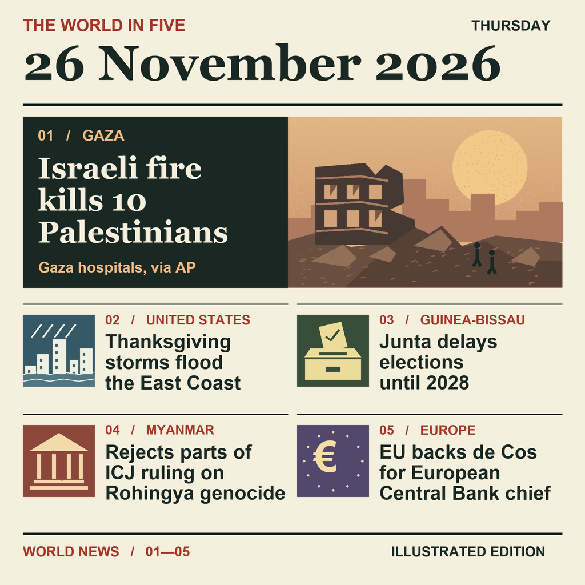

# The World in Five — 26 November 2026

[](https://make.fun/bounty/news-image-20261126)
[](https://make.fun/bounty/news-image-20261126/leaderboard)
[](https://make.fun/bounty/news-image-20261126)

An illustrated front page for Thursday, 26 November 2026. Five dispatches cover civilian harm, severe weather, elections, international justice and monetary policy. The scenes are original editorial illustrations, not documentary reconstructions.



## Run

```sh
MAKEFUN_OUTPUT_DIR=out python3.13 main.py
```

The default output is `/output/entry.png`. The runner requires no network, packages or fonts. To redraw the artwork on macOS, run `python draw.py entry.png` with Pillow 13.0.0 and the standard supplemental Arial Bold and Georgia Bold fonts; the authoring tool is not part of the judging runtime.

## Reporting notes

Editorial cutoff: 27 November 2026, 02:08 UTC. Times below are source publication timestamps on 26 November, not precise event times.

| Dateline | Reporting and editorial scope |
| --- | --- |
| Gaza | [AP, 07:51 UTC](https://apnews.com/article/522676f17532b878878ff7a4347d0e31): hospitals reported ten Palestinians killed by five Israeli strikes and a shooting overnight and Thursday. The illustration is not a depiction of a specific strike. |
| United States | [AP, 13:22 UTC](https://apnews.com/article/e8bc9bc454c933dacffe89b1139c4d3c): Thanksgiving storms flooded East Coast communities. The image is about Thursday's flooding, not the parade delay announced Wednesday. |
| Guinea-Bissau | [AP, 17:53 UTC](https://apnews.com/article/2d79de9288a79740c0bce093c004a14c): military authorities postponed presidential and legislative elections until November 2028. |
| Myanmar | [AP, 10:43 UTC](https://apnews.com/article/2722adf3c380f04c4ff627340f04d45d): state media reported that the country's leader would refuse to comply with parts of the ICJ's Rohingya genocide ruling. The ruling itself was earlier. |
| Europe | [European Council, 23:50 CET (22:50 UTC)](https://www.consilium.europa.eu/en/press/press-releases/2026/11/26/european-council-puts-forward-pablo-hernandez-de-cos-as-next-president-of-the-european-central-bank/): leaders put forward Pablo Hernández de Cos for ECB president; formal confirmation was still pending. |

Entered on [make.fun](https://make.fun/bounty/news-image-20261126). MIT licensed.
